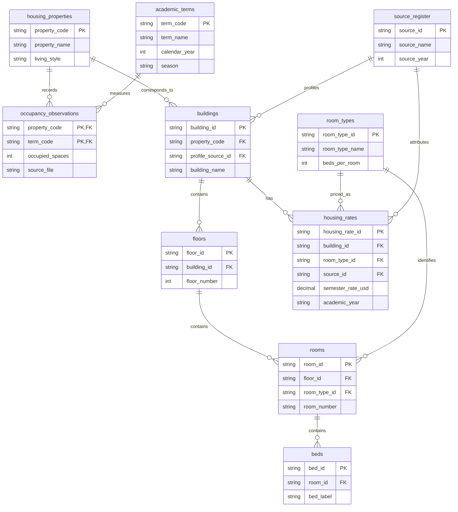
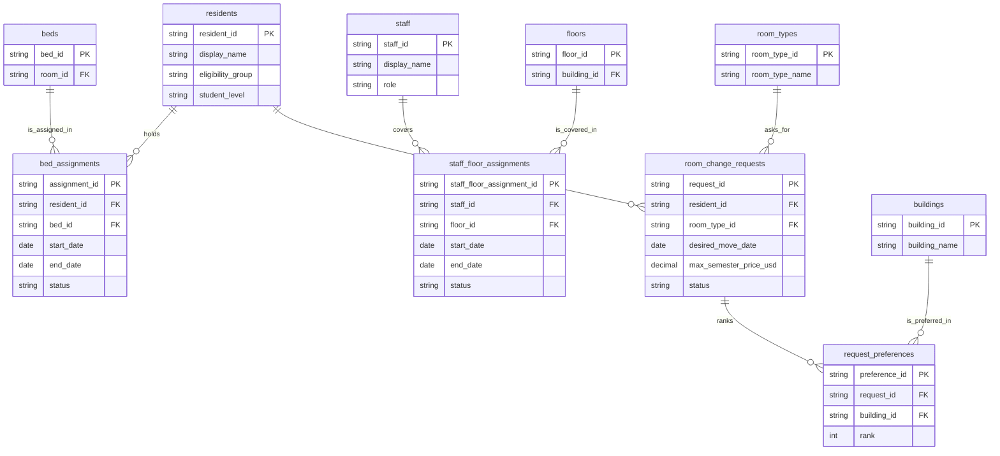

# Implemented HousingOps relational model

**Milestone 2, 16 PostgreSQL tables.** This is the implemented structure in [`sql/01_schema.sql`](../sql/01_schema.sql), not only the provisional Milestone 1 diagram. Two diagrams separate historical/reference information from operational workflows for readability. Cardinalities below use one-to-many relationships; mandatory references are enforced by `NOT NULL` foreign keys.

## A. Public historical occupancy and physical inventory

The 25 historical housing properties and six terms form **150 observations**, keyed by `(property_code, term_code)`. Only four source-linked named buildings are included in the **synthetic** room/bed inventory. This separation avoids representing source-level occupied-space totals as detailed 2026 room assignments.

## B. Housing operations, RA coverage and requests

## Design choices

- **Normalization:** Historical observations reference property and term rather than repeating their labels. Room, bed, floor, and building records are distinct physical levels. A request's preferred buildings are **separate ranked rows**, not a comma-separated field. Semester rates are separate by building, room type, and academic year.
- **Primary keys and cardinalities:** An observation has composite PK `(property_code, term_code)`. All other tables have individual text identifiers. Each child points to one parent; a parent may have zero or many children. `UNIQUE` rules additionally protect one room number per floor, bed label per room, rank per request, and rate per combination.
- **Date integrity:** Confirmed bed assignments cannot overlap for the same bed **or resident**; active RA floor assignments cannot overlap for the same staff member, using `btree_gist` exclusion constraints on half-open date intervals `[start_date, end_date)`.
- **CRUD rules:** `request_preferences.request_id` references its request with `ON DELETE CASCADE`, enabling safe deletion of a fictional draft/test request and its preferences. A partial unique index permits at most one **pending** request per resident.
- **Scope/limitations:** The fictional staff-coverage policy allows multiple RAs to cover one floor but prevents one RA from serving overlapping floors. Cross-table hall/rate eligibility is validated by the Python generator/loader; it is not fully protected from arbitrary direct SQL writes. The matching SQL proposes candidate beds but does not perform a transactional room transfer.

For the complete field types, keys, and constraints, consult the executable [schema](../sql/01_schema.sql).
